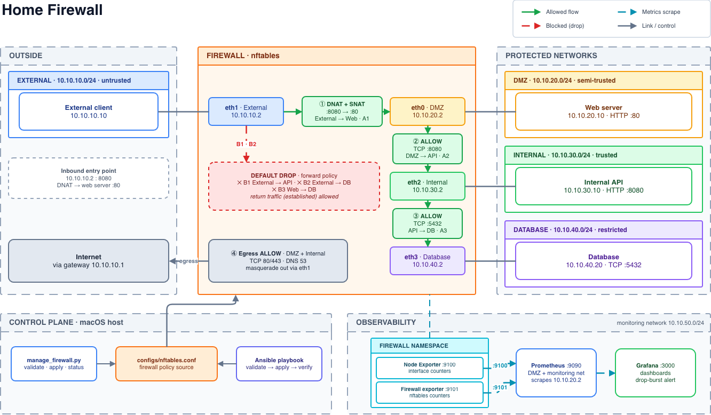

# Home Firewall

A segmented network gateway built on Linux **nftables**. It enforces default-deny forwarding between external, DMZ, internal, and database networks, exposes live traffic and firewall metrics through Prometheus and Grafana, and ships with automated deployment and security tests.



## Features

- **Network segmentation** — five isolated subnets: external, DMZ, internal, database, and monitoring.
- **Default-deny firewall** — an nftables forwarding chain that drops everything except explicitly allowed paths.
- **Controlled access paths** — external clients reach the web server, the web server reaches the internal API, and the API reaches the database. Nothing else is forwarded.
- **NAT** — DNAT publishes the web server on the firewall's external address; masquerading handles approved outbound traffic.
- **Observability** — interface counters and nftables accept/drop counters scraped by Prometheus, with Grafana dashboards and a drop-burst alert.
- **Automation** — Python, Bash, and Ansible tooling to validate, apply, inspect, and test the ruleset.

## Architecture

The diagram above reads left to right: packets enter from the external network, pass through the firewall's interfaces and rules, and reach the protected networks.

### Networks

| Network | Subnet | Purpose |
|---|---|---|
| External | `10.10.10.0/24` | Outside clients and WAN side |
| DMZ | `10.10.20.0/24` | Public-facing web server |
| Internal | `10.10.30.0/24` | Internal API |
| Database | `10.10.40.0/24` | Isolated database endpoint |
| Monitoring | `10.10.50.0/24` | Prometheus and Grafana |

Prometheus is also attached to the DMZ network so it can scrape the firewall exporters at `10.10.20.2`.

### Firewall interfaces

| Interface | Address | Network |
|---|---|---|
| `eth1` | `10.10.10.2` | External |
| `eth0` | `10.10.20.2` | DMZ |
| `eth2` | `10.10.30.2` | Internal |
| `eth3` | `10.10.40.2` | Database |

### Traffic policy

| # | Source | Destination | Port / protocol | Result |
|---|---|---|---|---|
| ① | External client | Web server | TCP `8080` on `10.10.10.2`, DNAT to `:80` | Allow |
| ② | DMZ | Internal API | TCP `8080` | Allow |
| ③ | Internal API | Database endpoint | TCP `5432` | Allow |
| ④ | DMZ / Internal | Internet | TCP `80`, `443`; DNS `53` | Allow, masqueraded via `eth1` |
| — | Everything else | Any | Any | **Drop** |

The forwarding chain has a default `drop` policy. Established and related traffic is allowed so permitted connections receive their replies.

## Monitoring

Prometheus scrapes two exporters every 5 seconds. Both share the firewall's network namespace:

- **Node Exporter** (`:9100`) — network-interface byte counters.
- **Firewall exporter** (`:9101`) — reads nftables JSON output and exposes accepted/dropped packet and byte counters, plus per-rule packet counters.

Grafana uses Prometheus as its data source. The dashboards cover incoming and outgoing traffic and firewall accept/drop metrics. A sample alert fires when more than five packets are dropped within a rolling one-minute window; treat that threshold as a starting point and tune it to your traffic.

## Automation

| Component | Role |
|---|---|
| `scripts/manage_firewall.py` | Validates the nftables file, applies it, and prints the live forwarding chain |
| `scripts/security_tests.sh` | Runs six connectivity checks: three expected to succeed, three expected to be blocked |
| `ansible/firewall.yml` | Validates the ruleset, applies it through Docker Compose, and prints the forwarding chain |
| `monitoring/firewall_exporter.py` | Exposes nftables counters in Prometheus format |

Ansible runs on the control host and reaches the firewall through Docker Compose.

## Validation

| ID | Path | Expected |
|---|---|---|
| A1 | External client → Web server (DNAT, TCP 8080) | Allow |
| A2 | Web server → Internal API (TCP 8080) | Allow |
| A3 | Internal API → Database (TCP 5432) | Allow |
| B1 | External client → Internal API | Block |
| B2 | External client → Database | Block |
| B3 | Web server → Database | Block |

## Getting started

### Requirements

- Docker and Docker Compose
- Python 3
- Ansible (a Python virtual environment is recommended)

### Start the services

```bash
docker compose up -d
docker compose ps
```

### Apply the firewall rules

```bash
python3 scripts/manage_firewall.py validate
python3 scripts/manage_firewall.py apply
python3 scripts/manage_firewall.py status
```

### Run the security tests

```bash
chmod +x scripts/security_tests.sh
./scripts/security_tests.sh
```

The allowed-path tests expect the test HTTP and TCP services to be running in the web, API, and database containers.

### Deploy with Ansible

```bash
source .venv-ansible/bin/activate   # if you use a virtual environment
ansible-playbook -i ansible/inventory.ini ansible/firewall.yml
```

### Open the dashboards

- Prometheus: <http://127.0.0.1:9090>
- Grafana: <http://127.0.0.1:3000> (use the credentials configured for your Grafana instance)

## Project structure

```
.
├── docker-compose.yml          # services and networks
├── firewall/Dockerfile         # firewall / endpoint image
├── configs/nftables.conf       # firewall policy source
├── scripts/
│   ├── manage_firewall.py
│   └── security_tests.sh
├── ansible/
│   ├── firewall.yml
│   └── inventory.ini
├── monitoring/
│   ├── prometheus.yml
│   └── firewall_exporter.py
```

## Tech stack

- Linux networking: IP forwarding, routing, `nftables`, `tcpdump`
- Docker and Docker Compose, Debian-based containers
- Python 3 (standard library) and Bash
- Prometheus and Node Exporter
- Grafana
- Ansible